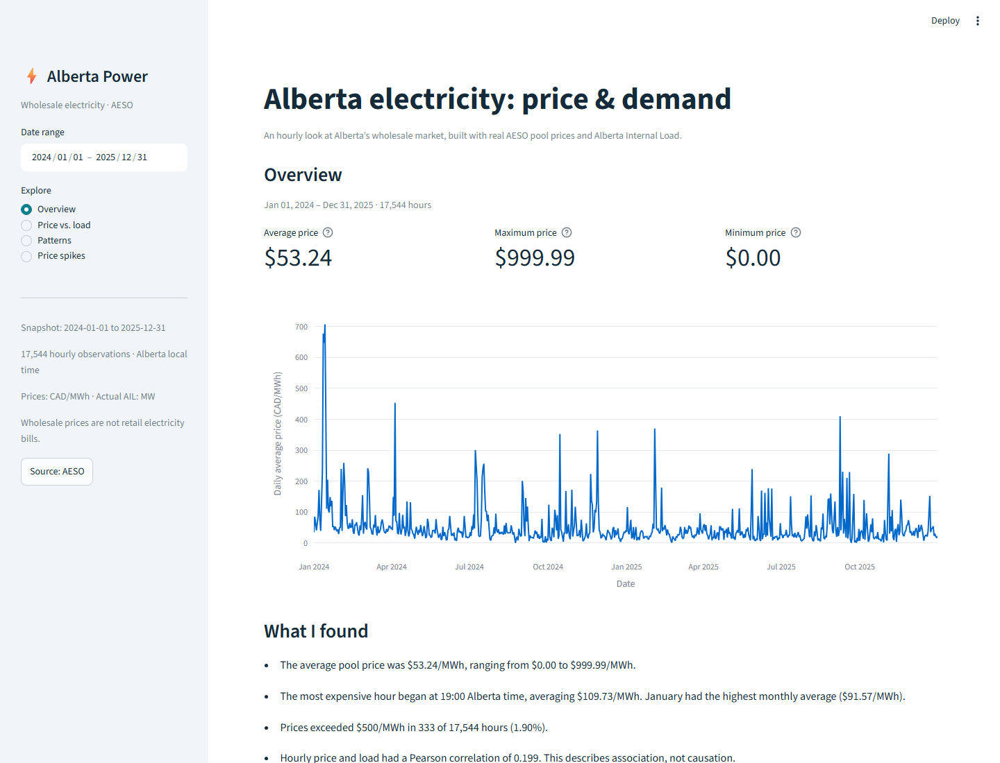

# Alberta Power Dashboard

A small energy analytics portfolio project exploring how Alberta's wholesale electricity pool price moves with demand. It uses **17,544 real hourly AESO observations from January 1, 2024 through December 31, 2025**, with a reproducible download pipeline, pure Pandas analysis functions, and an interactive Streamlit dashboard. Explore price statistics, price versus actual Alberta Internal Load (AIL), seasonal and hourly patterns, and hours above $500/MWh. Prices are in Canadian dollars per MWh; load is in MW.

**Live app:** Deployment pending on Streamlit Community Cloud.



## Main findings

Across the complete 2024–2025 snapshot:

- Average pool price was **$53.24/MWh**, with a minimum of **$0.00** and maximum of **$999.99/MWh**.
- The hour beginning **19:00 Alberta time** had the highest average price, **$109.73/MWh**. January had the highest pooled monthly average, **$91.57/MWh**.
- **333 hours (1.90%)** exceeded **$500/MWh**.
- Hourly price and actual load had a Pearson correlation of **0.199**: a weak positive linear association, not a causal relationship or a forecasting model.

Findings are descriptive of this period, and update in the app when the date range changes. Supply outages, fuel costs, imports, renewable generation and market changes are not controlled for. Wholesale prices are not retail bills.

## Run locally

Use Python 3.12 or newer (locally tested with Python 3.14).

```bash
git clone https://github.com/Kingjr101/alberta-power-dashboard.git
cd alberta-power-dashboard
python -m venv .venv
```

Activate the environment with `.venv\Scripts\Activate.ps1` on Windows PowerShell, or `source .venv/bin/activate` on macOS/Linux. Then:

```bash
pip install -r requirements.txt
pytest
streamlit run app.py
```

The committed CSV makes the app work immediately, without an API key or a live AESO connection. The sidebar date filter applies to all four pages and the CSV download. Streamlit's sidebar collapses on narrow screens.

## Refresh data

Register at the [AESO developer portal](https://developer-apim.aeso.ca/), subscribe to **AESO Public API**, and copy a subscription key from your profile. Put it in an untracked `.env` file:

```text
AESO_API_KEY=your_key_here
```

```bash
python src/fetch.py --start-year 2024 --end-year 2025
```

Without year arguments, the script uses the two latest complete calendar years. It requests monthly batches, retries temporary errors, and joins **actual** price and **actual** AIL by UTC hour. It rejects missing timestamps, conflicting duplicate readings, nonfinite values and nonpositive load before replacing the CSV. It does not interpolate, substitute forecasts or discard price spikes. Exact duplicate records are collapsed. Review and commit `data/hourly.csv` and `data/metadata.json` after a refresh; update these README findings if the period changes. Never commit `.env`.

## Data and methodology

Data credit: **Alberta Electric System Operator (AESO)**, [public API documentation](https://www.aeso.ca/market/market-and-system-reporting/aeso-application-programming-interface-api/).

- Pool price endpoint: `https://apimgw.aeso.ca/public/poolprice-api/v1.1/price/poolPrice`
- Actual load endpoint: `https://apimgw.aeso.ca/public/actualforecast-api/v1/load/albertaInternalLoad`
- Snapshot: 2024-01-01 to 2025-12-31 inclusive in Alberta time; 17,544 unique UTC hours; no missing hours. Retrieval time and SHA-256 checksum are recorded in `data/metadata.json`.
- CSV columns: `timestamp_utc`, `timestamp_alberta` (including UTC offset), `pool_price_cad_mwh`, `ail_mw`.
- Date filters and patterns use `America/Edmonton`. UTC joins preserve both autumn clock-change hours; spring's skipped local hour has no observation. All timestamps denote the **beginning** of an hour.
- Price averages are arithmetic hourly means, not load-weighted prices. Month patterns pool the selected years. The scatter includes every selected hour, with a NumPy ordinary least-squares line and Pearson correlation.
- Spikes are strictly **greater than $500/MWh**. Frequency divides spike hours by all observed hours in the selected range; consecutive hours are counted individually.

Independent student project; not affiliated with or endorsed by AESO. Source data remain subject to [AESO's terms of use](https://www.aeso.ca/legal/).

## Deploy on Streamlit Community Cloud

1. Sign in at [share.streamlit.io](https://share.streamlit.io/) with GitHub.
2. Click **Create app → Yup, I have an app**.
3. Choose repository `Kingjr101/alberta-power-dashboard`, branch `main`, and file `app.py`.
4. Choose an available app URL; in Advanced settings use Python 3.14 (or 3.12+). No secrets are needed because the dashboard reads the committed CSV.
5. Click **Deploy**, confirm the app is public, and replace the pending live link above with the assigned URL.

## Project layout

```text
app.py                 Streamlit pages and Plotly charts
src/fetch.py           AESO download, cleaning and completeness checks
src/analysis.py        Pure analysis functions
data/hourly.csv        Committed hourly snapshot
data/metadata.json     Source, retrieval time, coverage and checksum
tests/                 Analysis and data-validation tests
docs/dashboard.png    Actual local dashboard screenshot
```
